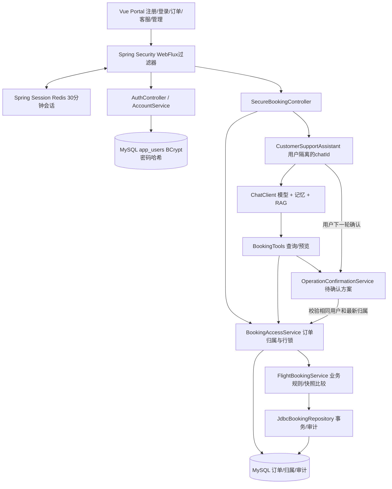
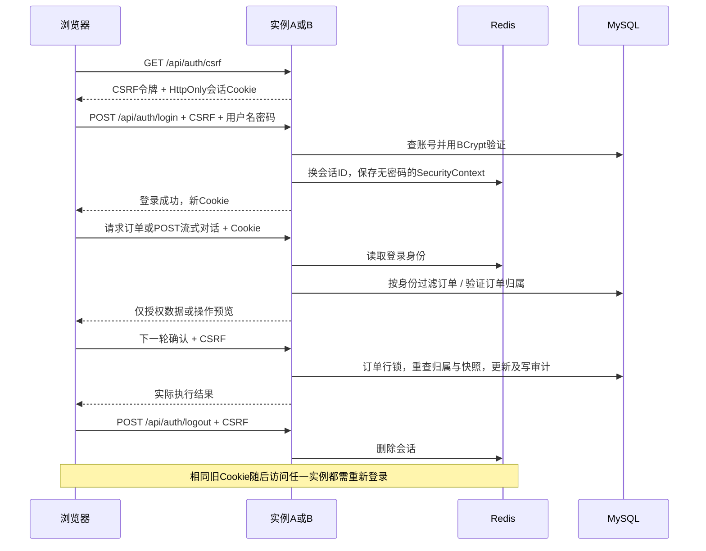

# 登录、Redis 共享会话与订单权限指南

本次扩展在官方售后示例上增加账号与订单归属，保留既有 RAG、工具、确认方案、事务及审计逻辑。没有接入真实购票或支付。

## 1. 第一次使用

1. 启动 MySQL 和 VMware 中的 Redis。连接地址目前默认 `192.168.64.129:6379`；虚拟机 IP 改变时设置 REDIS_HOST。
2. 在项目根目录运行 `./build.ps1`，然后双击 `start.cmd` 或 `start-mysql.cmd`。两个入口现在均启用 `mysql,secure`。
3. 依次在本机隐藏输入 MySQL 密码、Redis 密码、初始管理员密码、百炼完整 API Key。初始管理员密码至少12字符，默认用户名 `admin`。密码不写入配置文件；既有管理员存在时，初始密码输入可留空，输入新值不会重置既有密码。
4. 等待 `Started AgentApplication`，打开 http://localhost:9000 。第一次使用先注册一个普通账号，然后退出，用管理员登录。
5. 展开“管理员：分配已有模拟订单”，刷新用户列表，将需要测试的订单分配给刚注册的账号。历史订单不会根据乘机人姓名自动归属。
6. 退出管理员，使用普通账号登录。订单列表只显示分配给这个账号的订单。输入订单上的真实姓名和编号，请求改签；阅读具体方案后再回复“确认”。查看操作记录核对日期、航线和操作账号ID。
7. 使用另一个普通账号登录，应看不到第一账号的订单。即使在聊天中输入别人的姓名和编号，也不能查询或生成可执行方案。

显示名称不等于乘机人姓名。账号可以拥有多位乘机人的订单；展示名和聊天文本都不作为权限依据。现有管理员只用于本机演示管理，后续可增加独立后台、账号停用、找回密码和更细角色。

## 2. IDEA 配置

打开项目根目录的 pom.xml，等待 Maven 导入；JDK选择17，运行 `AgentApplication`。Program arguments 改为：

```text
--spring.profiles.active=mysql,secure --server.port=9000
```

在本机运行配置的环境变量中填写：`DB_PASSWORD`、`REDIS_PASSWORD`、`AI_DASHSCOPE_API_KEY`。首次创建管理员还需 `ADMIN_PASSWORD`（至少12字符），之后删除该项即可。可选 `DB_HOST`、`DB_PORT`、`DB_NAME`、`DB_USERNAME`、`REDIS_HOST`、`REDIS_PORT`、`REDIS_USERNAME`（默认 default）、`REDIS_DATABASE`、`ADMIN_USERNAME`、`AI_CHAT_MODEL`。不要提交 IDEA 运行配置或截图中的密码。

启动前先停止旧进程，避免9000冲突。Redis不可用时会话服务不能正常工作；不应临时关闭认证来排查。没有 `secure` 的默认或 mysql profile 仍保留原教学演示接口，页面会明确提示无登录，不能公开部署。通用 `start.ps1` 仍是底层脚本，完整体验使用上述 cmd 入口。

## 3. 架构和调用顺序





## 4. 各模块为什么这样设计

| 源码（模块内） | 职责与原因 |
|---|---|
| auth/SecurityConfiguration | 区分教学和完整模式；保护 `/api/**`，管理员路径限制 ADMIN；开启 CSRF；通过 EnableRedisWebSession 替换进程内 WebSession |
| auth/AuthController | 注册、登录、当前账号、退出和 CSRF；登录成功显式保存 SecurityContext 并更换会话ID，退出销毁会话 |
| auth/AccountService | 参数化SQL读取账号、BCrypt哈希与首次管理员创建；注册角色固定USER，前端不能提交ADMIN提权 |
| auth/AppPrincipal、UserIdentity | principal由服务端创建；DTO不含密码，ToolContext只携带应用注入的用户ID和角色，不使用模型生成的身份 |
| auth/BookingAccessService | 列表在SQL中过滤，工具查询校验归属；执行和管理员分配都锁相同订单行，避免权限检查与写入间的竞态 |
| auth/SecureBookingController | 接口读取登录主体；chatId前缀加入用户ID；阻塞JDBC业务放到 boundedElastic；聊天改用带CSRF的POST SSE |
| auth/AuditActor | 仅在同步JDBC事务范围传递操作账号，finally清理线程变量；不跨响应式线程隐式传递身份 |
| services/BookingTools | 输入编号来源约束之外，再做账号归属检查；工具只查数据或生成预览 |
| services/OperationConfirmationService | 保存预览所属身份；确认需身份一致，并在落库事务中重新查归属；保留原有过期、快照、重复确认保护 |
| db/migration/V1__users_and_booking_ownership.sql | Flyway增量迁移，保留旧订单/审计，新增用户、归属、分配审计和操作账号字段 |
| frontend/src/Portal.vue | 可点击的注册登录、退出、管理员分配、审计显示；登录后才挂载原客服页面 |
| frontend/src/auth.ts | 同源Cookie、获取CSRF令牌、错误处理、支持跨网络分块的SSE解析；登录过期清除界面数据 |

这里使用 **Spring Security + Spring Session Redis** 实现共享会话认证。多实例从同一个 Redis 命名空间读取登录状态；退出后可立即撤销后续请求的登录资格。同源网页使用 HttpOnly、SameSite=Lax Cookie，不需要把令牌保存在 localStorage。线上 HTTPS 应设置 `COOKIE_SECURE=true`，并通过正确的反向代理/TLS部署；当前本机HTTP默认false。

它没有实现独立 OAuth2/OIDC 认证中心或 JWT。分布式认证不要求必须使用JWT，也不等于已经拆成微服务。登录后的30分钟无操作会过期；Redis命名空间为 `flight:auth:session:v1`，与其他项目隔离，不执行 FLUSHDB。

## 5. Agent知识点：认证与工具执行边界

身份从 Cookie → SecurityContext → AppPrincipal → UserIdentity → 应用侧 ToolContext 传入。身份不放在可由模型填写的工具请求参数里，模型不能通过说“我是管理员”取得权限。

原 `BookingInputGuard` 回答“编号是否来自用户”；`BookingAccessService` 回答“当前账号是否拥有订单”；确认方案回答“用户是否同意这次具体变更”。这三层各解决不同问题，提示词不能替代任何一层后端授权。

记忆的键由后端组成 `u:<账号ID>:<浏览器chatId>`，不同用户提交同一个chatId也不会共享历史。待确认方案绑定此键和账号身份。管理员在预览之后重新分配订单时，原用户的确认将被拒绝。

RAG服务条款仍是所有用户共用的公开规则；订单不是向量检索出来的，必须通过受权限控制的工具查询。模型仍可能产生错误描述；预览和实际执行以Java结果为准。

## 6. 数据迁移、验证与限制

Flyway首次接管旧的非空库时以版本0建立基线，然后执行V1；空库直接执行V1。旧订单和旧审计保持，旧审计 `actor_user_id` 为NULL，新增执行记录保存账号ID。归属表独立于乘机人字段；重新分配写 `ownership_audit`。运行迁移前应按你的本机备份习惯备份数据库；MySQL DDL不保证整个迁移事务回滚，失败时先查看错误，不要盲目删除Flyway历史或清库。

自动测试使用隔离H2、模型替身和测试用共享会话仓库，不读取你的MySQL订单或调用真实模型。两HTTP实例测试检查：在A登录，B识别同一Cookie，B退出后A和B都拒绝旧Cookie。这个测试本身不证明真实Redis链路。

要在本机验证真实Redis共享会话，运行：

```powershell
powershell -NoProfile -ExecutionPolicy Bypass -File .\test-redis-session.ps1
```

脚本只在本机隐藏输入Redis密码，启动两个临时HTTP实例，数据库用独立H2、账号为测试账号，不访问业务MySQL、不调用百炼。Redis使用随机 `flight:test:session:*` 命名空间；不会清理其他项目的键。看到 DistributedSessionTest 两项通过且无跳过后，才算真实Redis双实例验证完成。普通 `mvn test` 会跳过真实Redis测试；仅凭此前PING成功不能声称该测试通过。

**当前边界：** 登录状态共享了，聊天记忆、条款向量和待确认方案仍在各实例内存。真实客服对话当前应使用单实例，或由网关对会话做粘滞路由；重启/切换实例可能需要重新生成预览。没有实现跨实例确认幂等表、OAuth2中心、验证码/登录限流、密码找回、完整的运营后台或真实航司支付。退出不会强行中断已经开始的请求，已开始的业务事务仍按其授权及锁完成。不要将本机教学配置直接当作生产安全配置。

官方参考：[Spring Session](https://spring.io/projects/spring-session/)、[Redis WebSession](https://docs.spring.io/spring-session/docs/3.5.x/api/org/springframework/session/data/redis/config/annotation/web/server/EnableRedisWebSession.html)、[WebFlux CSRF](https://docs.spring.io/spring-security/reference/6.5/reactive/exploits/csrf.html)。


## 7. 前端和测试命令

在模块 `frontend` 目录运行 `npm ci --ignore-scripts` 安装依赖，`npm run build` 生成dist。以package-lock.json为npm可复现安装依据，保留原yarn.lock仅供上游源码参考，不要混用两种包管理器。前端开发代理已改为9000。复制dist/index.html到模块src/main/resources/templates，其余dist文件复制到src/main/resources/static，再重新打包Java；项目已带构建好的资源。

前端验证：`npx vitest run src/auth.test.ts src/Portal.test.ts --pool=forks --maxWorkers=1 --minWorkers=1`；类型检查：`npx vue-tsc --noEmit -p tsconfig.app.json`。Java在项目根目录按README中的Maven测试命令执行。当前Java66通过、1项真实Redis测试跳过；前端5通过。
