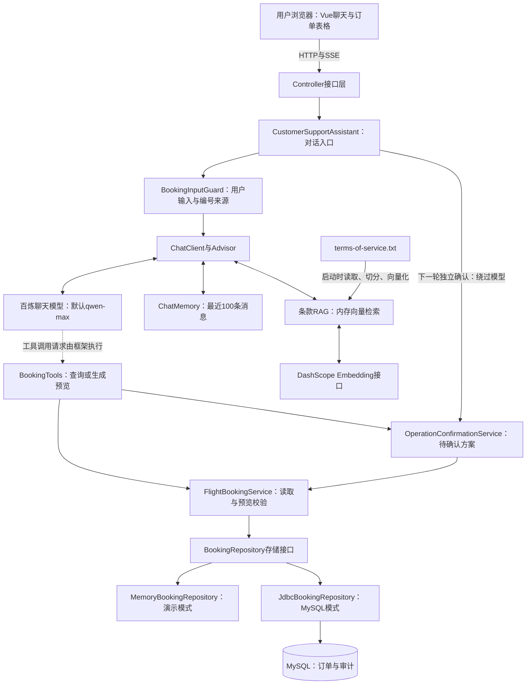
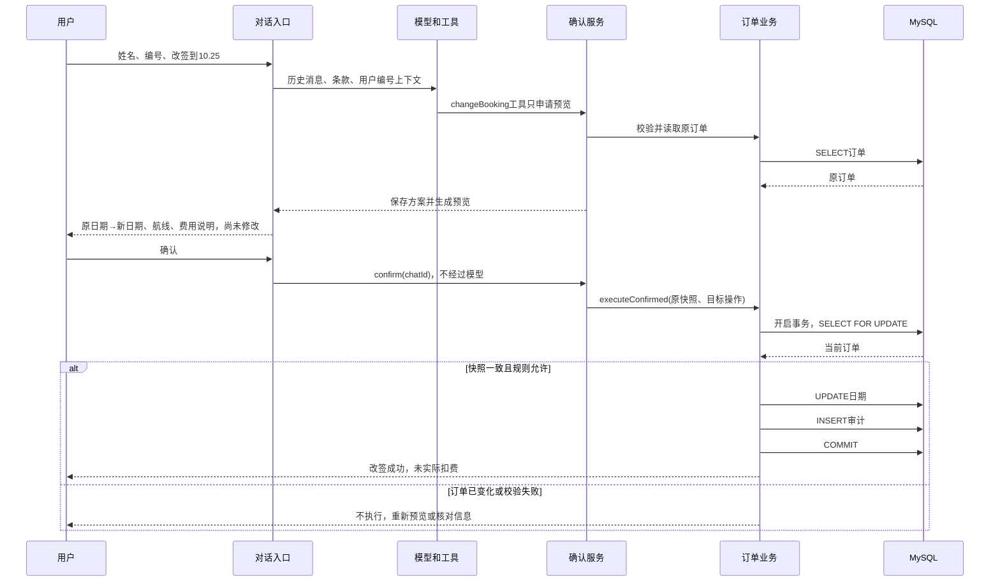
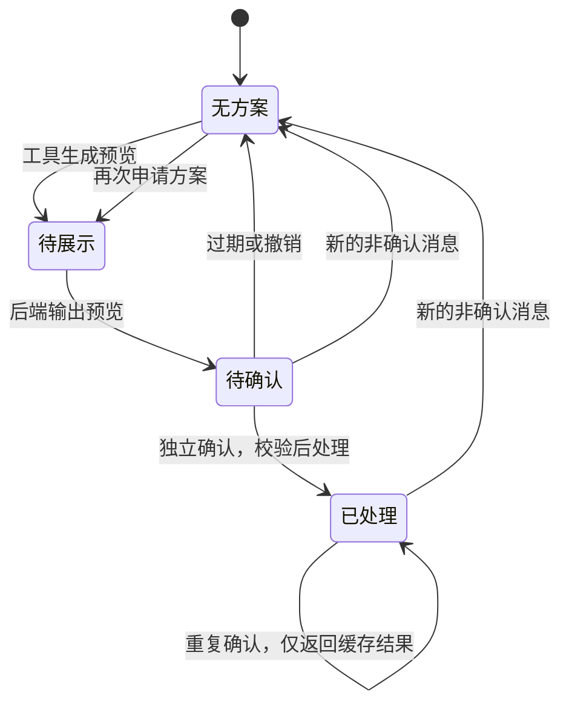
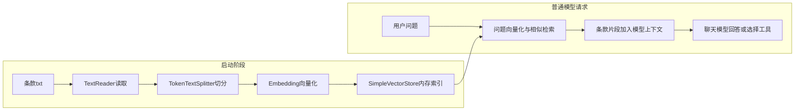
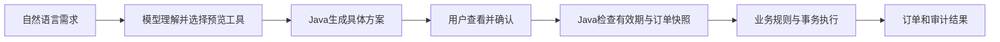

# 机票售后 Agent：源码、架构与面试讲解指南

> **2026-10-20版本更新：** 已加入注册登录、Redis共享会话、订单权限与Flyway迁移。启动入口现在启用 `mysql,secure`。请先阅读[登录认证与订单权限指南](登录认证与订单权限指南.md)，包含IDEA新配置、完整操作步骤、架构图、Agent身份传递及验证边界。下文旧版本的无登录/无迁移/内存启动描述仅是演进记录，以新指南为准。

版本：2026-10-17，依据当前本地源码、已打包依赖和已有测试报告整理。

## 1. 先用一句话理解项目

这是一个基于 Spring AI Alibaba 官方机票示例改进的 Java 机票售后 Agent：用户通过中文对话查询已有订单、提出改签或取消需求；模型负责理解与选择工具，Java 后端负责业务校验、操作预览、确认执行、MySQL 持久化和操作审计。

最值得记住的分工是：**模型理解需求，工具连接业务，Java 决定能不能执行，数据库记录实际结果。**

它服务的是已有订单售后。没有真实航空公司接入、新购票、库存、支付、退款到账或登录鉴权。条款中出现的费用是演示规则，不会真的扣钱。

## 2. 官方项目从哪里来，哪些是本地改进

### 官方链接

- [Spring AI Alibaba Examples 官方示例仓库](https://github.com/spring-ai-alibaba/examples)
- [playground-flight-booking 原始示例目录](https://github.com/spring-ai-alibaba/examples/tree/main/spring-ai-alibaba-agent-example/playground-flight-booking)
- [Spring AI Alibaba 框架仓库](https://github.com/alibaba/spring-ai-alibaba)

本地副本是 2026-10-17 从官方 main 分支源码压缩包提取的订票模块，保留了两层父 POM、许可证和原代码。**没有通过 git clone 保留 Git 历史，也没有记录可核实的原始 commit SHA。** 上面的 main 链接会随官方更新，不能当作当前本地代码的固定版本链接。

官方仓库确实提供 Spring AI / Spring AI Alibaba 示例，模块链接用于定位原始示例；以下对当前实现的解释以本地源码为准。

### 官方基础与后续工作

| 部分 | 官方示例基础 | 当前本地改进 |
|---|---|---|
| 对话 | ChatClient、中文提示、工具调用、记忆 | 按消息角色传递历史，显式配置100条消息窗口，用户姓名提示 |
| 条款 | 本地条款、切分、Embedding、向量检索 | 保留链路；增加启动检查开关，不冒充自研RAG框架 |
| 订单 | 5条随机初始化的内存订单 | 存储接口及内存/MySQL两种实现，空表才初始化 |
| 改签/取消 | 基础操作和日期限制 | 已取消订单保护、过去/非法日期拒绝、自然日期解析、航线保护 |
| 输入 | 主要靠模型提取 | 仅从用户消息提取编号；通过ToolContext限制工具编号来源 |
| 执行确认 | 主要靠提示词约束 | 模型仅生成预览，后端绑定具体方案并在下一轮确认后执行 |
| 审计 | 没有当前新增的审计表 | 修改前后快照、执行结果、事务一致性、审计查询 |
| 数据修复 | 无此次本地修复 | 从可信历史审计补回缺失航线，写REPAIR记录 |
| 本机使用 | 示例工程配置 | Windows构建/启动脚本、镜像配置、静态资源映射修复及文档 |
| 验证 | 原示例运行体验 | 现有报告累计54项自动测试，结合多轮本机人工验收 |

面试时可以说“基于官方示例二次开发”。如实说明使用AI辅助编码，重点证明自己理解、验证过哪些设计和问题；不要说整个框架和示例都是从零独立编写。

## 3. 实际技术栈：用途和证据

| 层次 | 当前技术 | 项目中具体负责什么 |
|---|---|---|
| 开发语言 | Java 17，本机17.0.18 | 业务校验、工具、事务、记录类型record |
| 应用框架 | Spring Boot 3.5.7 | 启动、依赖注入、自动配置、profile配置 |
| Web服务 | Spring WebFlux、Reactor、Netty | HTTP接口；Flux配合SSE传输聊天响应 |
| AI编排API | Spring AI 1.1.0 | ChatClient、Advisor、ChatMemory、VectorStore、ToolContext |
| 阿里云适配 | 实际jar为Spring AI Alibaba DashScope 1.1.2.1 | 调用百炼聊天模型与Embedding接口 |
| 聊天模型 | 默认qwen-max，可通过AI_CHAT_MODEL覆盖 | 理解需求、生成回答、选择工具及参数 |
| 向量模型 | DashScope EmbeddingModel | 条款及问题的向量化；当前配置未显式锁定型号，不编造固定型号 |
| 条款检索 | TokenTextSplitter、SimpleVectorStore、QuestionAnswerAdvisor | 文本切分、内存相似检索、为回答补充条款 |
| 消息记忆 | MessageChatMemoryAdvisor + MessageWindowChatMemory | 按会话保存最近100条消息，按角色传递历史 |
| 数据访问 | Spring JDBC / JdbcTemplate | 手写参数化SQL；没有使用MyBatis或JPA |
| 数据源 | HikariCP 6.3.3 | 连接池，当前最大5个连接，连接等待10秒 |
| 数据库 | 本机MySQL 8系列；Connector/J 9.4.0 | 保存订单和审计；驱动版本不等于数据库服务器版本 |
| 事务 | TransactionTemplate、数据库行锁 | 订单快照比较、变更和审计写入；审计失败时回滚 |
| JSON | Jackson | HTTP数据、审计前后快照序列化 |
| 前端 | Vue 3、TypeScript、Vite 5、Ant Design Vue 4 | 聊天界面、订单表格、前端开发构建 |
| 首页入口 | Thymeleaf模板 + 编译后的Vue静态资源 | Java服务提供index页面，交互UI由Vue实现 |
| 构建 | Maven；本机3.9.4 | 管理Java依赖、测试、打包Spring Boot jar |
| 前端工具环境 | 本机Node 24.16.0、npm 11.13.0（交接环境） | 改前端后重新构建；日常运行已打包页面不需要启动Node |
| 测试 | JUnit 5、Mockito、H2 | 业务、事务与回滚、模拟模型、预览确认等测试 |
| 数据库客户端 | Navicat | 人工建库、查看数据，不是运行时架构的一层 |

版本证据主要来自根POM、子模块POM和当前jar的BOOT-INF/lib。父POM里Alibaba BOM版本与实际DashScope组件版本不是一回事：框架/扩展依赖管理最终解析出了1.1.2.1组件。前端package.json使用部分版本范围，不能把范围下界当作当前安装的精确版本。

三个不要混淆的点：

1. **没有Graph工作流引擎或多Agent协作。** 当前是ChatClient、工具、Advisor及自定义确认流程；“Agent”体现在模型会选择调用工具。
2. **WebFlux不等于全链路非阻塞。** JdbcTemplate是阻塞访问，确认服务还用了synchronized；当前适合单实例演示，没有高并发压测结论。
3. **Java17不支持Java21的虚拟线程。** 虽然示例配置含虚拟线程开关，不能声称当前Java17运行已经用了虚拟线程。

## 4. 怎么在 IntelliJ IDEA 打开源码

### 4.1 打开哪个文件

启动IDEA，在欢迎页选择Open（打开）；已经在其他项目里时可用File → Open。

选择最外层 [pom.xml](pom.xml)，以项目方式打开：

```text
C:\Users\Osborn\Documents\Codex\2026-10-17\n\outputs\flight-booking\pom.xml
```

如果弹出信任提示，确认这是自己的本机项目后再信任。等待Maven同步及索引结束。目录打开后没有识别为Maven时，可右键根pom.xml，选择Add as Maven Project（添加为Maven项目）。不需要重新下载源码，也不要新建一个空项目。

### 4.2 设置JDK和Maven

1. File → Project Structure（项目结构）→ Project，Project SDK选择本机JDK17，语言级别与17一致。
2. Settings（设置）中搜索Maven，定位Build Tools → Maven。不同版本中文译名略有不同。
3. Maven home选择已安装Maven3.9.4或兼容的Maven3版本。
4. User settings file选择根目录的 [maven-settings.xml](maven-settings.xml)，需要时勾选Override。
5. Local repository选择本项目已使用的缓存目录，需要时勾选Override：

```text
C:\Users\Osborn\Documents\Codex\2026-10-17\n\outputs\flight-booking\.m2\repository
```

6. Maven Importer及Runner的JDK也选择17，然后在Maven工具窗口Reload All Maven Projects。

这样可以复用已下载依赖。仅设置SDK并不能代替Maven导入；仅设置镜像也不会自动让IDEA使用脚本指定的本地仓库。

步骤依据JetBrains的[导入项目说明](https://www.jetbrains.com/help/idea/import-project-or-module-wizard.html)及[Maven设置说明](https://www.jetbrains.com/help/idea/maven.html)。

### 4.3 源码在哪里

在左侧Project视图依次展开：

```text
flight-booking
└─ spring-ai-alibaba-agent-example
   └─ playground-flight-booking
      ├─ src/main/java/ai/spring/demo/ai/playground
      │  ├─ AgentApplication.java
      │  ├─ client
      │  ├─ services
      │  ├─ repositories
      │  └─ data
      ├─ src/main/resources
      │  ├─ application.properties
      │  ├─ application-mysql.properties
      │  ├─ rag/terms-of-service.txt
      │  ├─ templates/index.html
      │  └─ static/assets
      ├─ src/test/java
      └─ frontend/src
```

Java业务源码看src/main/java，测试看src/test/java，前端源文件看frontend/src。target是编译产物，.m2是下载依赖；都不应作为业务代码修改。backups是迭代前备份，不是正在运行的第二套模块。

在IDEA按Shift两次可搜索类；Ctrl+单击跳到定义；Alt+F7查看调用位置。最先搜索AgentApplication和FlightBookingService。

### 4.4 只读代码与直接运行是两回事

只看源码无需填写密钥。直接在IDEA运行时，找到 [AgentApplication.java](spring-ai-alibaba-agent-example/playground-flight-booking/src/main/java/ai/spring/demo/ai/playground/AgentApplication.java)，点击main方法旁的运行图标。

在生成的Application运行配置中设置：

| 配置 | 值/处理方式 |
|---|---|
| JRE | JDK17 |
| Use classpath of module | playground-flight-booking |
| Working directory | 项目根目录即可，主要资源从classpath读取 |
| Program arguments | `--spring.profiles.active=mysql,secure --server.port=9000` |
| 环境变量AI_DASHSCOPE_API_KEY | 本机填写完整有效百炼密钥 |
| 环境变量DB_PASSWORD | 本机填写MySQL密码 |
| DB_HOST / DB_PORT / DB_USERNAME / DB_NAME | 默认localhost / 3306 / root / flight_booking，可覆盖 |

不要把真实密码放进源码、命令行参数或共享的运行配置。IDE中的环境变量只在本机配置，不发送到聊天。

脚本中隐藏输入的密钥仅传给脚本启动的进程，**不会自动传给一个独立启动的IDEA进程**。所以脚本能跑，不代表IDEA运行配置已拥有密钥。

如果9000端口已由start-mysql.cmd启动的程序占用，先在旧窗口Ctrl+C停止，再在IDEA启动。也可让IDEA使用9001，但两个进程连接同一个数据库时会共享订单，待确认方案却各在各的内存，学习阶段建议只开一个服务。

IDEA运行源码能立即调试新Java代码；双击脚本运行的是target中的jar，修改源码后需要重新打包才能生效。只浏览源码时无需停止当前应用。

### 4.5 IDEA运行时审计接口出现参数名错误怎么办

若报错包含`Name for argument ... not specified`和`-parameters`，表示Spring无法获取某个Controller参数的名字，并不表示MySQL审计表丢失或改签失败。原审计接口使用`@RequestParam(required=false)`，依赖编译时保留参数名；Maven父POM启用了`-parameters`，某些IDEA编译设置却未保留它。

当前已修复为`@RequestParam(name="bookingNumber", required=false)`，由注解明确指定URL字段名，不再依赖编译参数。聊天接口原本就显式指定了chatId和userMessage，所以能正常使用。修改后在IDEA停止当前运行实例，Build → Build Project，再重新运行AgentApplication。无需删除数据库、重建订单或再次提交改签。

新增BookingAuditControllerTest将真实Controller源码用不含`-parameters`的编译选项重新编译，确认反射参数名确实不可用，再验证有筛选参数和无参数两种HTTP请求。

## 5. 三层POM与业务分层不是一回事

```text
根pom.xml                         父级依赖版本和构建配置
  └─ spring-ai-alibaba-agent-example/pom.xml  示例分类聚合
       └─ playground-flight-booking/pom.xml  真正运行的应用
```

父POM提供依赖管理/构建配置，通过modules聚合子模块。当前只保留订票链路，便于导入和构建。**不是三个独立服务，也不是三个独立部署的系统。**

同样，client、services、repositories、data是Java包和职责层次，不是微服务模块。

## 6. 总体架构图



文字版：浏览器 → 接口层 → 对话入口 → 输入/记忆/条款/模型 → Java工具 → 预览 → 用户确认 → 业务校验 → 存储层 → MySQL订单和审计。

图中“模型调用工具”是逻辑关系：模型输出工具名称及JSON参数，Spring AI在Java应用内解析并调用已注册函数，再把结果交给模型。模型不会直接获得数据库连接，也不会自己运行SQL。

浏览器访问的仍是一个Spring Boot应用。Vue构建资源随jar一起提供；百炼是外部API，MySQL是外部数据库，内存向量与会话存储则在应用进程内。

## 7. 各个类的职责与联系

| 类/文件（可点击） | 职责 | 主要联系 |
|---|---|---|
| [AgentApplication](spring-ai-alibaba-agent-example/playground-flight-booking/src/main/java/ai/spring/demo/ai/playground/AgentApplication.java) | main入口；装配ChatMemory、VectorStore；启动时导入条款 | EmbeddingModel、TokenTextSplitter、SimpleVectorStore |
| [BookingController](spring-ai-alibaba-agent-example/playground-flight-booking/src/main/java/ai/spring/demo/ai/playground/client/BookingController.java) | 首页模板及订单列表 | FlightBookingService |
| [AssistantController](spring-ai-alibaba-agent-example/playground-flight-booking/src/main/java/ai/spring/demo/ai/playground/client/AssistantController.java) | 接收chatId和userMessage，返回SSE | CustomerSupportAssistant |
| [BookingAuditController](spring-ai-alibaba-agent-example/playground-flight-booking/src/main/java/ai/spring/demo/ai/playground/client/BookingAuditController.java) | 最新100条审计，可按订单过滤 | FlightBookingService |
| [CustomerSupportAssistant](spring-ai-alibaba-agent-example/playground-flight-booking/src/main/java/ai/spring/demo/ai/playground/services/CustomerSupportAssistant.java) | 区分确认/撤销/普通消息；提供ToolContext；组合记忆、RAG、模型；展示后端预览 | InputGuard、ConfirmationService、ChatClient |
| [BookingInputGuard](spring-ai-alibaba-agent-example/playground-flight-booking/src/main/java/ai/spring/demo/ai/playground/services/BookingInputGuard.java) | 只从用户消息取编号和姓名提示，保留最近明确编号组 | 不信任助手编造的编号；不是认证系统 |
| [BookingTools](spring-ai-alibaba-agent-example/playground-flight-booking/src/main/java/ai/spring/demo/ai/playground/services/BookingTools.java) | 用@Bean和BiFunction注册工具，检查编号来源；查询或生成方案 | FlightBookingService、ConfirmationService、ToolContext |
| [OperationConfirmationService](spring-ai-alibaba-agent-example/playground-flight-booking/src/main/java/ai/spring/demo/ai/playground/services/OperationConfirmationService.java) | 按会话存方案；预览、展示、过期、撤销、确认及重复确认处理 | 内存Map、Clock、FlightBookingService |
| [FlightBookingService](spring-ai-alibaba-agent-example/playground-flight-booking/src/main/java/ai/spring/demo/ai/playground/services/FlightBookingService.java) | 规则校验、预览、确认快照比较、实际写操作与审计协调 | Repository、FlightDateParser、AuditRecord |
| [FlightDateParser](spring-ai-alibaba-agent-example/playground-flight-booking/src/main/java/ai/spring/demo/ai/playground/services/FlightDateParser.java) | 将日期简写转换为LocalDate；不自动把过去日期推至下一年 | 业务层继续判断日期是否合法 |
| [BookingRepository](spring-ai-alibaba-agent-example/playground-flight-booking/src/main/java/ai/spring/demo/ai/playground/repositories/BookingRepository.java) | 定义查询、写入、事务和审计能力 | 两种存储实现，业务层不依赖SQL细节 |
| [MemoryBookingRepository](spring-ai-alibaba-agent-example/playground-flight-booking/src/main/java/ai/spring/demo/ai/playground/repositories/MemoryBookingRepository.java) | 内存订单和审计；本机同步执行 | 默认profile，重启清空 |
| [JdbcBookingRepository](spring-ai-alibaba-agent-example/playground-flight-booking/src/main/java/ai/spring/demo/ai/playground/repositories/JdbcBookingRepository.java) | 建表、空表初始化、参数化SQL、事务、行锁、审计及空航线恢复 | mysql profile、JdbcTemplate、TransactionTemplate |
| [DemoBookings](spring-ai-alibaba-agent-example/playground-flight-booking/src/main/java/ai/spring/demo/ai/playground/repositories/DemoBookings.java) | 保留原示例随机生成5条订单的逻辑 | 内存启动或MySQL空表时调用 |
| [Booking](spring-ai-alibaba-agent-example/playground-flight-booking/src/main/java/ai/spring/demo/ai/playground/data/Booking.java)、[Customer](spring-ai-alibaba-agent-example/playground-flight-booking/src/main/java/ai/spring/demo/ai/playground/data/Customer.java) | Java订单与客户对象 | 不是JPA实体，没有依赖注解自动建表 |
| [BookingAuditRecord](spring-ai-alibaba-agent-example/playground-flight-booking/src/main/java/ai/spring/demo/ai/playground/data/BookingAuditRecord.java) | 不可变审计记录、前后快照及JSON转换 | 只保留日期、状态、航线、舱位等快照 |
| [前端页面](spring-ai-alibaba-agent-example/playground-flight-booking/frontend/src/views/home/index.vue) | 聊天消息、EventSource、发送锁、订单刷新 | 调用assistant接口和bookings接口 |
| [条款文件](spring-ai-alibaba-agent-example/playground-flight-booking/src/main/resources/rag/terms-of-service.txt) | 退改规则知识来源 | RAG导入，不是数据库中的订单数据 |

补充：原有BookingData类仍保留，但当前存储主链路已转到Repository，不应把“这个类存在”误解为它仍负责MySQL数据管理。

## 8. 请求接口与数据流

| 地址 | 返回/用途 | 是否修改订单 |
|---|---|---|
| `GET /` | 首页模板与Vue页面入口 | 否 |
| `GET /api/bookings` | 订单JSON列表 | 否 |
| `GET /api/assistant/chat?chatId=...&userMessage=...` | text/event-stream聊天响应 | 普通需求只生成方案；独立确认可能执行 |
| `GET /api/booking-audits` | 最新100条审计JSON | 否 |
| `GET /api/booking-audits?bookingNumber=101` | 101的最新审计 | 否 |

现有部分Controller用@RequestMapping，没有全部限制HTTP方法；上表列的是前端实际使用方式。当前没有独立的对外“执行改签REST接口”；确认由聊天入口识别后直接进入Java确认服务。

前端为页面实例生成chatId，用EventSource接收服务端消息。前端发送时加锁并对URL参数编码，流结束/出错后关闭连接并刷新订单列表。**SSE是服务端向浏览器推消息，不是WebSocket双向长连接。**

当前对话仍是GET查询参数，且完成/网络错误共用onerror处理，后续可以改为POST流式请求并区分结束与错误事件。它能本机演示，但不要描述成已经完成生产级通信协议。

## 9. 跟一次完整改签：这是最重要的流程

假设101属于云小宝，原日期10月22日、深圳到上海。实际日期以本机数据库为准。

### 第一步：用户提出需求

“我是云小宝，预订号101，改签到10.25。”

1. Vue把chatId与消息发到AssistantController。
2. CustomerSupportAssistant发现不是独立确认，撤销该会话旧方案。
3. BookingInputGuard从用户消息和最近历史识别当前编号101；它忽略模型回复中的编号。
4. ChatClient带上消息记忆、姓名提示、条款检索内容和ToolContext调用模型。
5. 模型选择changeBooking工具，传入订单、姓名、日期。工具函数检查编号是否在应用提供的集合里。
6. 工具调用OperationConfirmationService.preview，业务层只校验并读取，不写订单。
7. 后端保存原订单完整快照、目标日期、方案有效期及对应chatId/turnId。
8. Java生成固定预览，展示日期变化、航线、条款费用与“订单尚未修改”。预览后到达的模型文字会被过滤，避免把方案说成已执行。

此时刷新订单接口，日期仍是旧值；也没有新增成功执行审计。

### 第二步：用户确认

下一轮单独发送“确认”或“是”。

1. CustomerSupportAssistant用确定性匹配识别确认，直接调用confirm(chatId)，不调用聊天模型。
2. 查找同会话已展示的方案；未展示、过期或不存在则不执行。
3. 标记方案已处理，避免同时或再次确认重复执行。
4. executeConfirmed进入事务，读取并锁定订单，对比当前值与预览快照。
5. 如已被其他操作改动，拒绝并要求重新预览；否则再次校验规则。
6. 日期改签SQL只更新flight_date，不能清空航线。
7. 同一事务插入审计：原日期、新日期、航线、状态、结果。
8. 提交成功后返回后端结果；订单接口和审计都可以核对。



文字版：提出需求 → 读取并生成预览 → 用户看到方案 → 下一轮确认 → 锁定并比较订单 → 再校验 → 更新订单及写审计 → 提交。

注意：确认使用内存方案和缓存结果实现单实例内的重复执行保护；并不是有一个跨重启的数据库幂等请求表，也没有实现分布式Exactly Once。

### 第三步：修改、撤销、过期与重复确认



这是理解用的状态图；代码中实际用Map条目及shown/consumed等字段表达，没有一个同名状态枚举。任何非确认消息（包括费用提问）都会使旧方案失效，是目前偏保守的设计；要继续执行就需要重新生成预览。

方案默认5分钟有效；过期条目的清理由生成新预览时触发，不是后台定时任务。缓存有数量限制，但还不是完善的生产会话存储。

## 10. RAG、记忆和数据库，各自解决什么

| 数据/能力 | 回答的问题 | 当前存在哪里 |
|---|---|---|
| 订单 | 101是谁的、哪天出发、是否取消 | MySQL模式的flight_bookings，或演示内存 |
| 条款RAG | 改签规则、取消时间、条款费用说明 | 本地条款文件及应用内向量索引 |
| ChatMemory | 用户前几轮说过什么、当前谈哪笔订单 | 按chatId区分的应用内消息窗口 |
| 待确认方案 | 用户将要确认的具体变更是什么 | ConfirmationService的应用内Map |
| 审计 | 某次实际执行/业务尝试发生了什么 | MySQL的booking_audit，或演示内存 |

### RAG流程图



RAG是“检索增强生成”：先找相关条款，再提供给模型参考。它没有训练或微调模型，也不能取代后端规则。模型回答“可以改签”不代表数据库真的允许；代码还要检查状态、日期和方案。

当前QuestionAnswerAdvisor加在普通ChatClient链路上，并未做一个独立的“仅条款问题才检索”的路由器；因此普通模型请求也可能发生检索，存在调用成本与延迟的优化空间。独立确认由后端处理，会绕过这条模型/RAG链路。

默认启动会调用Embedding接口构建条款索引，故密钥错误能导致整个启动失败。app.rag.initialize=false只是跳过启动导入；**不会自动关闭后续聊天中的RAG或模型调用**，不能把它说成“聊天离线模式”。

ChatMemory只保留最近100条消息，不是100轮完整对话。页面刷新生成新的chatId，服务重启也清空记忆。MySQL订单持久化不会自动让聊天或待确认方案也持久化。

## 11. 数据库结构、事务与审计

### 两张核心表

| 表 | 关键字段 | 作用 |
|---|---|---|
| flight_bookings | booking_number主键、customer_name、flight_date、booking_status、departure、destination、booking_class | 当前订单状态 |
| booking_audit | 自增id、booking_number、action、result、message、occurred_at、before_data、after_data | 操作记录；前后快照以JSON字符串存入TEXT |

两表通过booking_number建立业务关联，当前没有数据库外键。初始化是CREATE TABLE IF NOT EXISTS，不是JPA生成结构，也还没有Flyway/Liquibase版本迁移。

MySQL表为空时才插入5条模拟订单；重启不重新覆盖。内存模式则每次重新生成。航线初始值是随机的，不能把深圳到上海写成101永远固定的初始数据。

### 审计结果怎么读

| 字段值 | 说明 |
|---|---|
| action=CHANGE | 改签业务 |
| action=CANCEL | 取消业务 |
| action=REPAIR | 从历史审计恢复空航线 |
| result=SUCCESS | 执行成功 |
| result=REJECTED | 部分进入业务执行链路的规则拒绝 |
| result=NOOP | 内部取消业务发现已经取消，没有再修改订单 |

最新对话流程在预览时就可能发现“已取消”或日期非法，所以**不一定每次聊天失败都会新增REJECTED或NOOP**。未确认的方案没有执行审计；模型没调用工具、输入校验提前拦截、方案过期、数据库故障等也不是本表完整覆盖的安全事件。确认事务中的异常还可能使该事务内的审计回滚。

occurredAt接口中的Z表示UTC。例如09:10Z对应北京时间17:10，不表示审计时间少了8小时。

### 为什么用事务

订单更新和成功审计必须一起提交：

```text
BEGIN
  SELECT订单 ... FOR UPDATE
  比较原快照 + 重新校验
  UPDATE订单
  INSERT审计
COMMIT
```

审计插入失败时，订单更新应回滚；测试中通过故意让审计插入失败验证了这一点。TransactionTemplate显式组织事务，不是通过某个@Transactional方法自调用生效。嵌套业务事务默认参与已有事务，不能把每层方法看成独立提交。

行锁用于串行保护同一订单的确认执行，快照比较用于识别“用户看到预览之后订单已经变化”。此处比较的是记录字段，不是数据库version列的乐观锁实现；字段改动后又被改回的情况仍有改进空间。

### 航线修复为什么必要

真实测试曾暴露：模型给出空from/to，旧SQL把航线清空。修复后业务层沿用原航线，底层日期SQL只更新日期，明确改航线会拒绝。

已受损记录在MySQL启动时仅从最近100条审计寻找完整且匹配现有非空部分的快照；只补航线，不回退日期或状态；修复与REPAIR审计同事务。没有匹配快照就保留警告并拒绝继续改签，不让模型编造城市。

这是针对已复现缺陷的受控修复，不是通用数据恢复平台。

## 12. 启动、配置、构建和调试的实际区别

| 操作 | 使用方式 | 会发生什么 |
|---|---|---|
| 演示内存模式 | start.cmd | 必要时隐藏输入API Key，运行jar，订单不持久化 |
| MySQL模式 | start-mysql.cmd | 隐藏输入数据库密码，再调用通用启动脚本，以mysql profile运行 |
| Java重新打包 | build.ps1 | Maven package，当前脚本含-DskipTests，不代表自动执行测试 |
| IDEA调试源码 | main旁Debug | 运行编译后的源码类，可打断点；不依赖旧jar更新 |
| Maven测试 | IDEA测试类运行图标或Maven test | 默认自动测试用H2/内存和模拟模型，不消耗真实模型额度 |

默认端口9000，脚本-Port可覆盖。虽然application.properties支持PORT，start.ps1显式传入--server.port参数，脚本方式应以-Port为准，命令行参数优先于配置文件。

在项目根目录的PowerShell运行全部测试：

```powershell
mvn -s .\maven-settings.xml "-Dmaven.repo.local=$PWD/.m2/repository" -f .\spring-ai-alibaba-agent-example\playground-flight-booking\pom.xml test
```

### 前端开发需要额外注意

查看前端源码不需要安装Node依赖。运行当前jar已有前端资源，也不需要另开Vite。

若以后修改Vue：frontend/vite.config.ts中开发代理目前指向9001，而默认Java端口是9000。前后端分开开发前，要把代理和后端端口对齐；原配置注释里的示例地址不能当成已经对齐。

原frontend/package.json的build脚本会先运行yarn并格式化整个src，再调用Vite；不要把它当作已经验证过的干净增量构建。本轮前端小修是同步Vue源码和已编译JS、校验JS语法并更新资源引用，没有完整重建前端依赖。后续正式整理前端构建时再固定包管理器和锁文件。

## 13. 54项测试覆盖什么，怎么自己读

| 测试类 | 当前报告数量 | 学习重点 |
|---|---:|---|
| FlightBookingServiceTest | 11 | 日期、状态、重复取消、工具结果 |
| BookingInputGuardTest | 5 | 用户编号来源、会话上下文、禁止虚构编号进入业务 |
| ConversationRegressionTest | 6 | 简写编号/日期、角色记忆、费用说明 |
| JdbcBookingRepositoryTest | 1 | 仓储重新创建后订单保留、初始化不覆盖 |
| StorageProfileTest | 2 | 两种存储模式装配与真实Spring工具注册 |
| BookingAuditTest | 7 | 前后快照、审计持久性、写审计失败回滚 |
| RoutePreservationTest | 8 | 空航线参数、旧数据修复、无历史不猜测 |
| OperationConfirmationTest | 12 | 预览无写入、确认执行、过期、跨会话、重复/并发确认、流式预览 |
| BookingAuditControllerTest | 2 | 不保留Java参数名时的筛选/无筛选HTTP绑定 |
| 合计 | 54 | 当前报告累计通过，0失败、0错误 |

H2是测试数据库，兼容模式不等于真实MySQL的全部行为。模拟模型用于可重复验证Java流程，不证明真实qwen每次都会正确选工具。54项也不是52次真实模型端到端调用，更不是压测指标。

此前确认流程的报告累计52项通过；本次又单独运行并通过2项审计接口HTTP参数绑定测试，现有报告累计54项通过，没有重复运行全部既有测试。真实百炼、MySQL和浏览器流程已有用户本机反馈；细节见 [验证记录](验证记录.md)。

### 推荐阅读与断点顺序

1. 先读Booking和BookingStatus，理解订单字段及状态。
2. 读FlightBookingServiceTest并运行一项不调用模型的测试，在FlightBookingService里打断点。
3. 读BookingRepository与MemoryBookingRepository，理解“接口隔离业务和存储”。
4. 再读JdbcBookingRepository，找到初始化、参数占位符、事务和FOR UPDATE。
5. 读BookingAuditTest的auditWriteFailureRollsBackOrderUpdate，观察为什么审计失败后订单恢复。
6. 读OperationConfirmationTest的previewDoesNotMutateAndConfirmationExecutesOnce，再跟confirm和executeConfirmed。
7. 最后读BookingTools、CustomerSupportAssistant、AgentApplication，理解AI能力如何接到业务上。
8. 读frontend页面的forHelp和bookings，串起浏览器到接口的最后一段。

不要从几千行依赖源码或编译JS入手。先理解自己的业务代码，再按需要进入框架实现。

## 14. 面试时怎么讲

### 60秒版本

我基于Spring AI Alibaba官方机票示例做了一个机票售后Agent，支持中文查询、改签和取消已有订单。底层用Spring Boot、Spring AI的工具调用与RAG，订单通过JdbcTemplate持久化到MySQL。我重点改进了模型到业务执行之间的边界：只允许用户提供的订单编号进入工具，改签先生成后端预览，下一轮确认后比较订单快照并在事务里执行，同时记录前后数据审计。另外修复了空航线参数覆盖数据的问题，并通过已有54项自动测试和本机流程验证。当前是单实例模拟业务，没有真实库存、支付或鉴权。

### 展开讲三个问题，比堆技术名词更有效

**问题一：为什么不能只写提示词？**

模型曾编造编号，也曾把空航线参数传进工具。提示词能引导表达，但不保证参数或数据库操作正确。所以编号来源校验、状态/日期校验、航线保护必须由Java实现。模型可以建议动作，不能绕过规则直接改数据。

**问题二：为什么预览和执行要分开？**

用户一句“改签到10.22”不代表已经同意具体订单与条款。模型判断“确认”也可能出错。我把模型工具改成只生成方案，后端保存快照和5分钟有效期。下一轮独立确认由Java识别，执行时重新读取并比较订单；重发确认只返回已处理结果。

**问题三：审计为什么和订单同事务？**

如果订单改了但审计没写，就无法追溯真实变化。我把订单更新与审计插入放在同一事务，审计失败则回滚订单。测试不是只断言方法被调用，而是故意让审计插入失败，再查询数据库确认订单没变。

### 高频追问与回答边界

| 面试问题 | 当前可以准确回答的内容 |
|---|---|
| 用MyBatis了吗？ | 没有，用JdbcTemplate手写参数化SQL；这是当前选择，不冒充用了ORM |
| 用了哪些设计思想？ | 按职责分层、Repository接口与多实现、业务规则独立于模型、预览与执行分离 |
| RAG和记忆有何区别？ | RAG查条款知识，记忆保留当前会话消息；订单真实状态要查数据库 |
| 怎么防模型编造？ | 不承诺消除所有文本幻觉，限制编号来源和可调用工具，写操作由Java规则与确认流程约束 |
| 如何保证幂等？ | 当前按会话保存已处理方案，并用同步保护单实例重复确认；未实现数据库幂等键或分布式Exactly Once |
| 并发如何处理？ | MySQL事务内行锁和快照比较保护具体订单；确认服务全局同步会限制并发，尚无压测结果 |
| 改签是严格24小时限制吗？ | 目前按LocalDate天数判断，不是带起飞时刻与时区的精确小时判断 |
| 如何鉴权？ | secure模式通过Spring Security和Redis会话识别账号，接口与工具按订单归属授权；姓名和编号仍不是认证凭证 |
| 重启后什么保留？ | MySQL订单、审计保留；聊天、向量索引、待确认方案需重新建立 |
| 项目从哪来的？ | 官方Examples的playground-flight-booking源码包，本地二次开发，无原始Git历史 |
| 有没有微调或训练大模型？ | 没有，调用百炼模型，使用RAG和工具调用完成应用编排 |

## 15. 一次5分钟演示怎么安排

1. 展示首页订单和官方来源，说明已有订单售后范围。
2. 用一条仍为CONFIRMED的订单提出改签到未来日期，展示后端预览。
3. 在订单接口或Navicat里证明预览阶段没有改数据。
4. 回到同一会话回复确认，展示日期变化和SUCCESS审计的前后快照。
5. 再次确认，证明没有重复执行审计。
6. 简述另一条已取消订单不能改签，以及审计失败回滚的自动测试。
7. 结束时主动说明没有实际扣费、登录或真实航空公司接入。

演示前查实际订单，不要把已取消订单用于“正常改签”演示。未来日期按演示当天调整；不缺省假定数据库始终是最初5条未操作的状态。

## 16. 已知限制与下一阶段顺序

这些是下一步工程化方向，不是已经完成的能力：

1. 登录、用户订单归属与审计访问权限。姓名/编号及前端chatId不能承担认证。
2. 持久化确认单、请求幂等键和按会话/订单的并发控制；当前全局synchronized和内存Map不适合多实例扩展。
3. 将阻塞JDBC从WebFlux事件线程合理隔离，或选择更一致的Web技术方案；需要压测后再谈吞吐。
4. 用统一规则配置管理条款与预览金额，减少txt条款和Java费用switch重复维护导致的漂移。
5. 对已完成订单等状态补齐状态机；加入精确起飞时刻、时区及真实费用业务，而不是把LocalDate规则说成精确小时。
6. 数据库迁移工具、索引、审计分页、脱敏与保留策略，以及独立记录系统异常的可观测性。
7. POST流式通信、清晰的完成/错误事件；完善前端独立构建和自动化浏览器回归。
8. RAG检索命中/引用可观测、针对不同意图的检索路由、评估集和成本统计；目前没有检索准确率或性能提升百分比。

建议先按第13节把源码和测试跑懂，再挑一项继续。简历中的每个技术点都应能指到一段自己理解的代码、一次验证或一个明确的设计取舍。

## 17. Agent知识点：用在了哪里，为什么这样用

本部分是学习索引：把Agent概念与本项目的真实代码对应起来。阅读每项时都问自己：**它解决哪个问题？代码在哪里？如果去掉会怎样？它还不能保证什么？**

### 17.1 先看知识点与代码对应总表

| Agent相关知识点 | 在本项目的落点 | 为什么使用 | 必须记住的边界 |
|---|---|---|---|
| 有限自主的Agent | ChatClient + 模型选择已注册工具 | 将自然语言需求连接到真实业务方法 | 模型的自主范围被工具和Java规则限制 |
| Tool / Function Calling | BookingTools的@Bean、BiFunction、请求record、@Description | 用明确参数调用Java方法，获得真实订单或方案 | 模型选择工具不代表参数正确；当前改签/取消工具只预览 |
| 系统提示词 | CustomerSupportAssistant.defaultSystem | 定义角色、功能范围、沟通方式及费用边界 | 提示词不是权限控制，也不是数据库约束 |
| 上下文组织 | 角色消息、姓名提示、RAG片段、ToolContext | 给模型和工具各自需要的信息，减少混淆 | 模型看到的信息与工具信任的信息不是同一个概念 |
| 多轮会话记忆 | MessageChatMemoryAdvisor + ChatMemory | 支持“先说姓名编号，再说日期”的分轮表达 | 内存、100条消息，不是长期记忆或100轮 |
| 检索增强生成RAG | AgentApplication导入条款，QuestionAnswerAdvisor检索 | 用项目条款辅助回答，减少只依赖模型自身知识 | 检索得到规则不代表规则已被Java强制执行 |
| Chunk / Embedding / Vector Search | TextReader、TokenTextSplitter、EmbeddingModel、SimpleVectorStore | 把条款转成可相似检索的片段 | 无模型微调；索引在内存，不在MySQL中 |
| Advisor组合 | defaultAdvisors中的记忆、RAG、日志 | 将通用AI请求处理组织成可组合的步骤 | 不是多Agent，也不是已经使用Graph引擎 |
| 应用侧工具上下文 | .toolContext和ToolContext | 将编号来源、chatId、turnId由应用传入工具 | 不让模型填写这些可信字段；但仍不等于用户鉴权 |
| Guardrails执行约束 | BookingInputGuard、业务校验、航线保护 | 拒绝未提供的编号及非法写入 | 不能承诺消灭所有文本幻觉或提示注入 |
| Human-in-the-loop人工确认 | OperationConfirmationService | 先让用户看到具体方案，再允许产生副作用 | 普通回复“是”只对当前有效、已展示方案有意义 |
| 工作流状态与有效期 | Pending、shown、consumed、expires | 表达待展示、待确认、已处理及过期 | 自定义单实例状态，没有持久化工作流引擎 |
| 结构化工具输入输出 | 请求record、BookingLookupResult、审计快照 | 让业务结果有可判断的字段，减少空对象歧义 | 不代表所有模型回答都被强制成JSON |
| 生成与执行分离 | 模型生成预览；executeConfirmed实际执行 | 将不确定的语言理解与确定的写操作分开 | 内部业务方法仍可直接调用，模型入口才被限制为预览 |
| 流式交互 | Flux、SSE、前端EventSource | 普通对话逐步展示，操作预览由后端输出 | 流式是传输机制，不证明推理或业务结果正确 |
| 工具结果可信依据 | 查询数据库、返回业务结果、核对审计 | 用程序实际状态纠正模型可能编造的描述 | 模型最终自然语言仍可能有误，接口和数据是核验依据 |
| Agent评估与回归 | 模拟模型测试、工具测试、本机真实对话 | 分开验证代码流程和真实模型表现 | 54项测试不是模型准确率、压测或52次真实API验证 |
| 成本与可观测性 | 绕过模型的确认、日志Advisor、审计 | 减少无必要的模型参与，并追踪实际变更 | 未做完整token统计、全链路追踪或成本看板 |

### 17.2 为什么它可以称为Agent，而不只是聊天接口

**概念：** 一个只把用户文本发给模型再显示回复的接口，主要提供对话能力。这里模型还可以根据需求选择工具、填写参数，工具访问订单系统并返回结果，模型据此继续回答。

**在哪里：** [CustomerSupportAssistant](spring-ai-alibaba-agent-example/playground-flight-booking/src/main/java/ai/spring/demo/ai/playground/services/CustomerSupportAssistant.java)的defaultToolNames注册了getBookingDetails、changeBooking和cancelBooking；[BookingTools](spring-ai-alibaba-agent-example/playground-flight-booking/src/main/java/ai/spring/demo/ai/playground/services/BookingTools.java)定义工具实现。

**为什么：** “请查我的101订单”需要数据库里的真实订单，不应由模型凭文字生成一个看似合理的结果。工具让模型有能力请求真实数据。

**当前范围：** 这是一个功能范围明确的单Agent应用。没有多个Agent互相分工，没有自动上网执行任意任务，也没有显式实现一个名为ReAct的推理图。可以讲“模型选择工具、观察结果并继续回答”，不要声称看到了模型隐藏思维链或实现了完整ReAct框架。

### 17.3 Tool Calling：模型如何调用Java

**在哪里：** [BookingTools](spring-ai-alibaba-agent-example/playground-flight-booking/src/main/java/ai/spring/demo/ai/playground/services/BookingTools.java)。请求record定义参数，例如订单号、姓名、日期；@Description解释工具用途；BiFunction的第二个参数是ToolContext。

**过程：**

```text
用户需求
  → 框架向模型提供工具名称、描述和参数结构
  → 模型返回“调用哪个工具、参数是什么”
  → Spring AI执行Java工具函数
  → Java查询/校验并返回结果
  → 模型基于结果继续生成文本，或后端展示固定预览
```

**为什么：** 接口明确、可以测试，并且让业务访问通过受控Java方法完成。模型不获得JDBC连接，也不负责生成SQL。

**本项目的重要变化：** changeBooking/cancelBooking名称沿用了示例，但当前描述和实现已改成“只生成预览”。真正的确认执行没有注册成模型工具。看代码时以函数实现和Description为准，不要仅凭旧名字断定会立即改数据库。

**常见误区：** JSON参数结构正确，不代表姓名、日期或航线在业务上正确。Schema主要说明结构，语义正确性还要由Java验证。

### 17.4 提示词工程：用于沟通规则，不能代替业务约束

**在哪里：** [CustomerSupportAssistant.defaultSystem](spring-ai-alibaba-agent-example/playground-flight-booking/src/main/java/ai/spring/demo/ai/playground/services/CustomerSupportAssistant.java)。它说明客服角色、中文回复、先查真实订单、不要编造编号、费用只是演示，以及工具仅生成预览。

**为什么：** 模型需要知道自己能做什么、怎么组织回复、什么时候补充提问。否则容易出现泛泛回答、重复问姓名、把模拟费用描述成真实扣款等问题。

**项目里的实际教训：** 曾经发生“模型说航线保留，但工具把空字符串写进数据库”。补充提示词有帮助，但最终解决问题的是业务层沿用原航线，以及日期改签SQL只更新日期。

**应当这样讲：** 提示词改善行为倾向；Java校验和工具权限约束实际执行。不能用“在system prompt里写了禁止”来证明某个操作绝不会发生。

### 17.5 上下文工程：把不同来源的信息放到正确位置

**在哪里：** CustomerSupportAssistant组装请求；BookingInputGuard提取用户输入；ChatMemory和RAG Advisor补充上下文；ToolContext传递应用字段。

| 信息来源 | 当前用途 | 为什么要分开 |
|---|---|---|
| system提示 | 定义角色与应用规则 | 避免每轮靠用户重复说明助手职责 |
| user/assistant历史 | 理解多轮省略表达 | “改签到10.22”可以延续前面说过的姓名和编号 |
| 条款检索片段 | 提供退改签知识 | 规则知识与用户自己的陈述不是一回事 |
| 工具实际结果 | 提供订单状态、查询失败或预览 | 真实数据不应由模型记忆替代 |
| ToolContext | 传递用户编号集合、chatId、turnId | 执行约束所需字段由程序控制，不让模型编造 |

当前提供给模型的姓名提示只从用户原话解析，不是查数据库后猜出的姓名。当前工具编号来源也只从用户消息获取，助手自己说出的B123456不会自动成为可用编号。

**为什么：** 不同来源的信息具有不同用途和可信程度。模型可以读历史助手回复，但工具不能因为助手曾编造一个编号就信任它。

**限制：** 用户自己提供编号不代表该订单属于这个用户；chatId也不是登录凭证。来源约束降低误调用风险，不能取代认证与授权，也不是完整的提示注入防护方案。

### 17.6 会话记忆：为什么能省略姓名和编号

**在哪里：** [AgentApplication.chatMemory](spring-ai-alibaba-agent-example/playground-flight-booking/src/main/java/ai/spring/demo/ai/playground/AgentApplication.java)创建maxMessages(100)的窗口；MessageChatMemoryAdvisor通过CONVERSATION_ID使用chatId读取、补充历史。

**使用示例：** 第一轮“云小宝，101”，第二轮“改签到10.22”。第二轮原文没有姓名和编号，应用从用户历史中提取当前编号，模型同时获得带角色的历史消息及姓名提示。

**为什么：** 降低重复输入要求，保留真实对话中常见的省略与指代。保留消息角色也有助于区分“用户真的提供过”与“模型曾经说过”。

**与其他存储的区别：**

- 聊天记忆保存“说过什么”。
- 方案状态保存“等待确认哪次操作”。
- MySQL订单保存“现在是什么状态”。
- 审计保存“哪些业务操作发生过”。

不能仅靠聊天记忆判断订单现在是否已取消；数据库可能已被其他请求改变。不能用一条历史“我同意”代替当前方案确认。

**限制：** 100条消息不是100个token，也不是100轮；消息长短不同，token和调用费用仍会变化。当前没有摘要压缩、跨重启长期记忆或向量化用户记忆。

### 17.7 RAG：为什么条款需要检索，但订单要用工具查

**在哪里：** [AgentApplication](spring-ai-alibaba-agent-example/playground-flight-booking/src/main/java/ai/spring/demo/ai/playground/AgentApplication.java)读取[条款文件](spring-ai-alibaba-agent-example/playground-flight-booking/src/main/resources/rag/terms-of-service.txt)，切分后调用Embedding写入SimpleVectorStore；CustomerSupportAssistant中的QuestionAnswerAdvisor在模型请求中加入检索内容。

**知识链路：** 文本读取 → 切成片段 → Embedding变成向量 → 相似检索 → 相关片段进入模型上下文 → 生成回答。

**为什么这么用：** 条款属于文档知识，按语义检索能支持“退票要提前多久”“经济舱改签费多少”等不同说法。每个问题都把全部文档塞给模型，在文档规模增长后会增加上下文长度和成本。

**为什么订单不用RAG查：** 订单日期、状态需要精确、及时的数据，还涉及条件匹配与事务。相似检索不是订单主键查询，也不能承担一致性保证，所以用JdbcTemplate按编号和姓名查询。

**为什么规则还写Java：** 检索是给回答提供依据，不能确保模型一定遵循。取消状态、过去日期、原航线保护等必须由代码强制执行。

**当前限制：** 向量索引在内存；每次正常启动会重新建立。没有做文档版本治理、检索命中率评估、回答引用校验或向量数据库部署。预览费用又在Java中有固定映射，存在与txt条款漂移的风险，后续宜统一规则来源。

### 17.8 Advisor：为什么把记忆、RAG、日志组合起来

**在哪里：** CustomerSupportAssistant.defaultAdvisors。

**当前组合：**

- MessageChatMemoryAdvisor补充并维护角色消息。
- QuestionAnswerAdvisor检索条款、补充知识上下文。
- SimpleLoggerAdvisor提供模型调用日志能力，实际输出还取决于日志级别。

**为什么：** 它们是多个对话请求都会需要的通用处理。如果全部手写到Controller里，HTTP接收、记忆维护、检索和模型调用会混在一起，后续难以理解和调整。

**边界：** Advisor是Spring AI请求处理扩展点，不是“几个Advisor等于几个Agent”。组合Advisor也不等于已经有显式工作流图、任务调度或分布式执行框架。

### 17.9 Guardrails：约束模型能做的动作

**具体落点与原因：**

| 保护 | 代码 | 如果没有会怎样 |
|---|---|---|
| 编号必须来自用户输入 | BookingInputGuard.collect/allows与ToolContext | 模型生成示例编号也可能进入业务查询/操作 |
| 非法日期和取消状态拒绝 | FlightBookingService、FlightDateParser | 语言上看似合理但业务非法的参数会被接受 |
| 空航线不覆盖 | 业务层校验、仓储日期更新SQL | 模型省略from/to时可能清空真实航线 |
| 写操作先预览 | 工具只调用confirmations.preview | 用户随口提出需求就可能立即改数据 |
| 方案与当前订单快照比较 | executeConfirmed、FOR UPDATE | 用户确认的是旧方案，实际订单却已发生变化 |
| 重复确认不重做 | consumed与同步处理 | 重发消息或并发确认可能重复执行 |

这些约束作用在执行入口和业务层，比单纯要求模型“不要出错”更容易测试。

**仍然不能承诺：** 完全防幻觉、完全防提示注入、用户已经认证、数据完全不泄露或系统已达到生产安全标准。当前订单和审计接口没有用户权限隔离，这是独立且重要的待办。

### 17.10 Human-in-the-loop：为什么确认必须绑定具体方案

**在哪里：** [OperationConfirmationService](spring-ai-alibaba-agent-example/playground-flight-booking/src/main/java/ai/spring/demo/ai/playground/services/OperationConfirmationService.java)的preview/present/confirm；[CustomerSupportAssistant](spring-ai-alibaba-agent-example/playground-flight-booking/src/main/java/ai/spring/demo/ai/playground/services/CustomerSupportAssistant.java)在普通模型请求之前处理独立确认。

**绑定的信息：** 当前会话、当前轮次、原订单快照、目标操作、目标日期、5分钟有效期、是否展示、是否已经处理。

**为什么：** “是”本身没有订单号、日期或操作类型。它只有在紧接某份清楚展示的方案时才有意义。让模型自行判断所有历史“同意”是否对应本次动作，会产生误执行风险。

**本项目的做法：** 模型无法调用一个“确认执行工具”。用户下一轮单独确认时，后端读取已经保存的方案，不重新让模型生成订单号或目标日期。任何非确认新消息会使旧方案失效，避免离题后的“好”误执行旧操作。

**这不是登录认证：** 人工确认解决“用户是否同意这份具体变更”，身份认证解决“当前用户是谁”，订单授权解决“他能否操作这笔订单”。三者不能互相替代。

**限制：** 当前方案在单实例内存中，且确认服务采用全局同步。跨实例部署需要共享/持久化方案和可靠的幂等策略；不能把当前实现称为跨系统Exactly Once。

### 17.11 Agent工作流：哪些交给模型，哪些写成确定性程序



**为什么这样分工：** 不同说法的理解适合由模型辅助；有效期、状态、日期比较、是否已处理、SQL更新则有明确规则，交给普通代码更可靠。

代码并没有把整个业务交给模型自由规划，也没有让模型看到一个工具后就拥有无限执行权限。它采用的是受控工具调用，加自定义的预览确认流程。

“生成方案”与“执行方案”分开后，模型即使把日期理解错，用户也有机会看到完整日期并拒绝。最终执行时仍要重新检查数据库，因为生成预览和用户确认之间存在时间间隔。

### 17.12 结构化结果、事实依据与错误处理

**在哪里：** BookingTools中的BookingLookupResult(success, message, booking)、请求record；BookingAuditRecord中的前后快照；业务规则抛出的明确拒绝结果。

**为什么：** 查询失败如果返回一个只有编号、其余为空的“订单对象”，模型可能仍把它当成查到订单。改为明确success=false、说明未找到、booking=null，更容易传达真实业务含义。

**事实依据的顺序：** 用户表达提供需求 → 查询工具提供订单事实 → Java校验决定能否执行 → 数据库及审计记录实际结果。模型自然语言不能替代最后两步。

预览生成后，应用会过滤随后到达的模型内容并输出后端生成的预览，避免把待确认方案说成已完成。这是当前特定输出路径的保护，**不是对整个模型文本进行全面事实核验**；工具调用前已经输出的文本仍不在这项保护的保证范围内。

预览被拒绝、没有调用工具、确认过期、数据库异常等，是不同类型的失败。不能把所有失败都包装成“订单不存在”，也不能把业务审计说成覆盖了所有聊天与系统异常。

### 17.13 SSE流式交互：用在哪里，为什么不是Agent推理能力

**在哪里：** AssistantController返回Flux与text/event-stream，前端EventSource接收消息；CustomerSupportAssistant使用stream().content()，并为后端预览和确认结果使用确定性Flux输出。

**为什么：** 普通模型回答可以逐步展示，改善等待体验；确认结果不需要再调用模型组织成一大段文字。

**区别：** SSE负责怎样传输结果，Tool Calling负责怎样请求能力，RAG负责怎样补充知识，Java规则负责怎样约束执行。这四件事不能混称为“Agent能力提升”。

即使界面逐字输出，也不代表模型内部推理过程可见，更不代表订单已经写入成功。界面锁和后端重复确认保护分别处理交互与业务执行问题，不能只靠按钮禁用来保证幂等。

### 17.14 Agent评估：为什么既要模拟测试，也要真实对话

**在哪里：** ConversationRegressionTest、BookingInputGuardTest、OperationConfirmationTest等，以及本机用户人工验收记录。

| 验证层次 | 本项目怎么做 | 能证明什么 |
|---|---|---|
| 业务规则 | 不同日期/状态/航线参数测试 | 非法变更被拒绝，合法变更按规则执行 |
| 工具边界 | 不可信编号和查询失败结果测试 | 工具入口的约束及结果结构符合设计 |
| 对话编排 | 模拟模型配合真实Advisor和ToolContext | 历史角色、上下文、预览展示等Java流程按预期工作 |
| 状态与确认 | 过期、跨会话、并发/重复确认、订单变化 | 单实例方案保护及执行路径符合测试条件 |
| 事务与持久化 | H2兼容测试与故意制造审计写入失败 | 在测试数据库条件下订单与审计的一致性 |
| 真实端到端 | 本机百炼、浏览器、MySQL人工操作 | 实际模型选工具、实际数据库和页面的该次行为 |

**为什么：** 模型输出具有不确定性；只跑真实聊天，失败很难重复定位。只测Java又发现不了模型会传空参数、选错工具或生成不实描述。两类验证互相补充。

**测试带来的实际改进：** 用户对话暴露问题 → 固定复现输入 → 修业务或编排边界 → 加回归用例 → 再做真实模型验收。航线清空、编号别名和不经确认执行就是这样的例子。

当前没有完整的意图识别准确率、工具选择成功率、RAG命中率、延迟分位数或token成本评估集。不能把54项测试通过换算成某个模型成功率或性能提升百分比。

### 17.15 成本和可观测性：已经做了什么，还没做什么

**已有：** 确认由后端处理，不再为一句“确认”调用聊天模型；固定的缺号追问也可以直接返回。日志Advisor辅助观察调用，订单审计保存实际业务变化。

**为什么：** 确认属于状态判断，没必要再付出模型调用的时间和成本；审计能帮助区分“助手说成功”和“数据库真的发生改变”。

**未完成：** 普通模型请求仍走RAG Advisor，没有独立的意图检索路由；没有按会话统计token、费用和工具耗时，也没有全链路trace平台。日志与审计不是同一种数据，不应把审计表当成模型调用监控系统。

这里的成本收益只是设计层面的原因，项目尚未测出具体节省金额或延迟百分比。

### 17.16 哪些Agent知识点目前没有使用

| 知识点 | 当前状态 | 正确说法 |
|---|---|---|
| 多Agent协作 | 未使用 | 单个售后Agent配多个Java工具 |
| 显式ReAct规划器/思维链日志 | 未实现 | 有工具调用和结果反馈，不声称拿到了隐藏推理 |
| Graph工作流引擎 | 未使用 | 预览确认是自定义Java状态处理 |
| MCP远程工具服务 | 未接入 | 当前工具是同一应用内注册的Java函数 |
| 模型微调/训练 | 未进行 | 调用现有百炼模型，使用提示、RAG和工具 |
| 长期记忆、对话摘要 | 未实现 | 最近100条消息窗口，应用重启清空 |
| 独立向量数据库 | 未部署 | 使用SimpleVectorStore内存索引 |
| 完整提示注入防御 | 未实现 | 做了部分执行入口约束，仍有认证/授权等缺口 |
| 跨实例、跨重启幂等 | 未实现 | 单实例内存方案和重复确认结果缓存 |
| 通用自主规划与任务重试 | 未实现 | 固定的订单售后业务与受控方案执行 |

### 17.17 怎么把这些知识点讲成自己的理解

不要只说“我用了RAG、Memory、Function Calling”。用“需求 → 代码 → 原因 → 验证 → 限制”来讲：

> 用户经常分几轮提供姓名、订单号和日期，所以我通过角色消息记忆保留上下文，并只从用户消息提取当前编号。模型能调用Java工具，但改签、取消工具只生成预览。后端保存具体订单快照，下一轮用户确认后再在事务里比较订单并执行。条款问答由RAG提供参考，状态和日期规则仍由Java强制检查。这样做是因为真实测试曾出现模型编造编号、传空航线参数和不实扣费描述。自动回归测试验证代码边界，真实对话验证模型表现；目前仍是单实例、无登录的模拟售后系统。

读完这一部分，你应当能回答：模型什么时候参与、工具什么时候被调用、哪些信息可信、何时真正写数据库、为什么要确认、如何验证，以及哪些能力目前根本没有做。


## 18. 新增：Agent与账号权限如何协作

详见[登录认证与订单权限指南第5节](登录认证与订单权限指南.md#5-agent知识点认证与工具执行边界)：ToolContext身份由服务端注入，记忆键加入账号ID，工具生成预览前检查订单归属，确认事务内重查归属。RAG仍只检索公开条款，不用于决定账号权限。Redis目前共享的是登录状态，聊天与确认方案仍在单实例内存。
